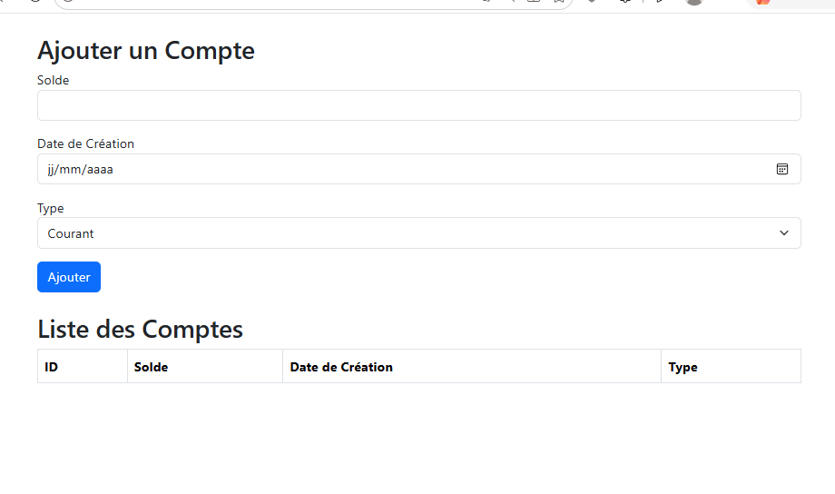
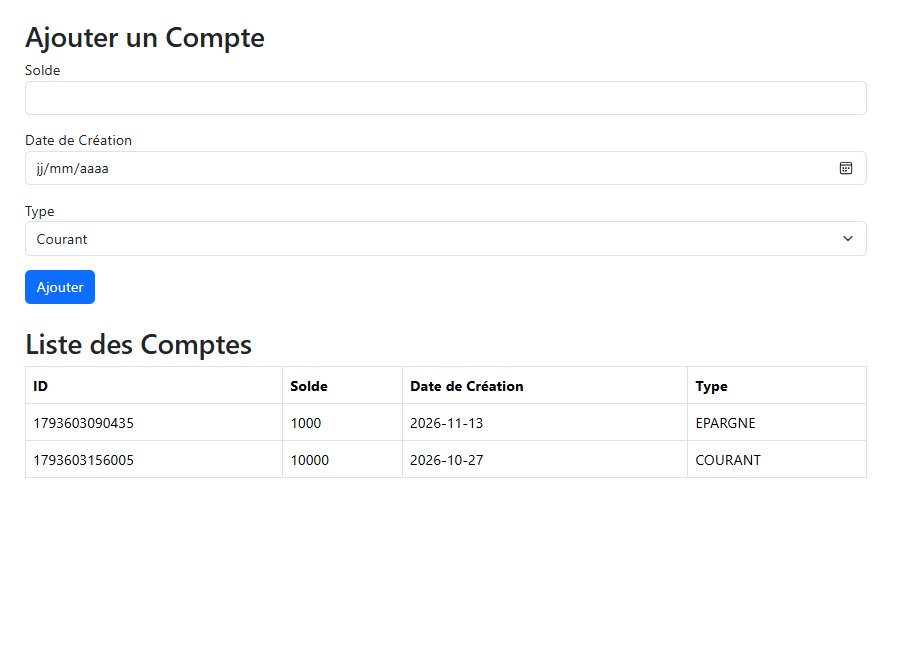

# TP 9 : Client React pour API REST

## 1. Structure du projet

## Description des fichiers

App.js : composant principal qui gère les comptes et partage les données entre le formulaire et la liste.

CompteForm.js : permet de saisir les informations d'un compte et de l'ajouter.

CompteList.js : affiche les comptes ajoutés dans un tableau.

config.js : contient l'adresse de base de l'API.

index.js : point d'entrée de l'application React.

## 2. Explication des résultats

L'application permet de gérer les comptes à travers une interface simple.

L'utilisateur peut :

Saisir le solde du compte.

Choisir la date de création.

Sélectionner le type du compte (Courant ou Épargne).

Ajouter le compte à l'aide du bouton « Ajouter ».

Consulter les comptes ajoutés dans un tableau.

Les données sont actuellement conservées dans le LocalStorage du navigateur.

 ## 3. Captures d'écran

Les captures d'écran suivantes présentent les différentes étapes de fonctionnement de l'application.

##  Interface principale

## Résultat après l'ajout d'un compte et  Liste des comptes

